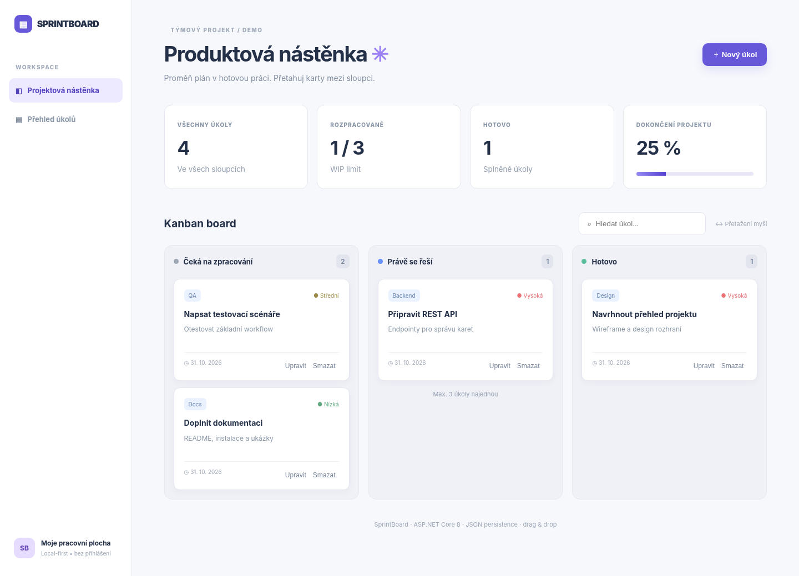

# ▦ SprintBoard — Kanban projektová nástěnka

Moderní webová aplikace postavená na **ASP.NET Core Minimal API**. Umožňuje spravovat úkoly v Kanban sloupcích, přetahovat karty myší, filtrovat, upravovat, mazat a sledovat průběh projektu.



## Funkce
- Vizuální nástěnka **Čeká / Právě se řeší / Hotovo**.
- Drag & drop s okamžitým uložením na server.
- REST API s CRUD operacemi a validací vstupů.
- **WIP limit:** maximálně 3 rozpracované úkoly (ověřuje i server, HTTP 409).
- Fulltextové hledání, priority, kategorie a procento dokončení.
- Lokální automatické ukládání do `data/cards.json` (soubor vznikne při spuštění).
- Bez databáze, npm a dalších NuGet balíčků.

## Spuštění
Potřebuješ **.NET SDK 8 nebo novější**.

```bash
dotnet run
```

Aplikace vypíše adresu, typicky `http://localhost:5000` nebo `https://localhost:5001`. Pro pevný port:
```bash
dotnet run --urls http://localhost:5050
```
Otevři **http://localhost:5050**.

## API
| Metoda | Endpoint | Popis |
|---|---|---|
| GET | `/api/cards` | Všechny karty; volitelně `?search=api&status=todo` |
| GET | `/api/stats` | Statistiky |
| POST | `/api/cards` | Nová karta |
| PUT | `/api/cards/{id}` | Úprava stavu / detailů |
| DELETE | `/api/cards/{id}` | Smazání |

Vytvoření karty:
```bash
curl -X POST http://localhost:5050/api/cards \
  -H "Content-Type: application/json" \
  -d '{"title":"Napsat testy","description":"Kontrola API","priority":"high","category":"QA"}'
```

Změna stavu (použij ID z odpovědi API):
```json
{"status":"progress"}
```

## Technologie
C# / .NET 8 · ASP.NET Core Minimal APIs · JSON · HTML/CSS · Vanilla JavaScript. Licence MIT.

## Upozornění
Aplikace je určená **pro lokální použití a demonstraci**. Nemá autentizaci ani řízení přístupu; nevystavuj ji bez zabezpečení na veřejný internet.
